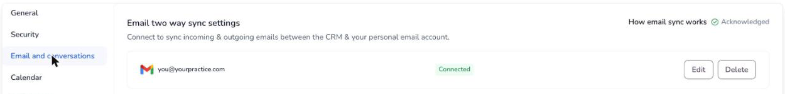
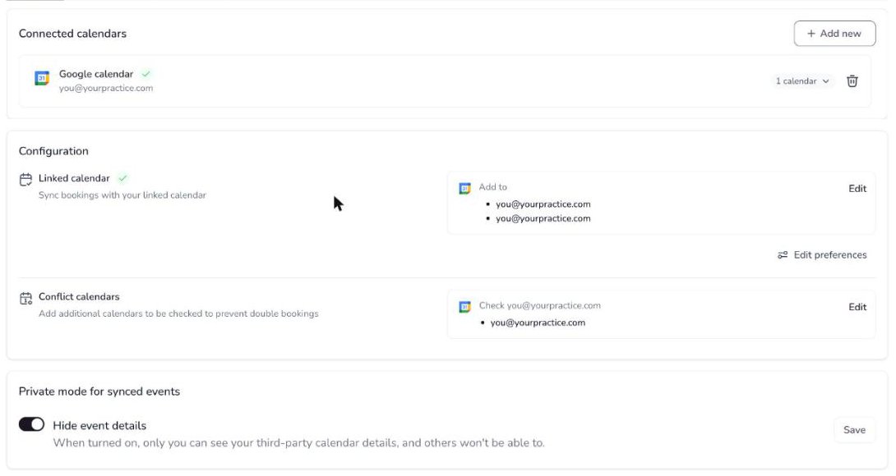

## Connect your email

1. Go to **Settings → My Profile → Email and conversations → Email (2-way sync)**.
2. Follow the connection prompts. You may be asked to approve permissions twice.

When it's connected, your email address shows a **Connected** label.

<Frame caption="Email two-way sync, connected">
  
</Frame>

### How email sync behaves

- Sync begins when you connect. It does not import your entire inbox history.
- Only messages involving existing PracticeOS contacts are synced. Email with someone who is not a contact is not pulled in.
- When you email a contact from your regular inbox, or they email you, the message appears in that contact's conversation in PracticeOS.
- Disconnecting later does not remove messages that were already synced.

## Connect your calendar

1. Go to **Settings → Calendars → Connections → + Add new**.
2. Choose your business calendar and complete the connection.

Once connected, the same screen lets you choose the calendar new bookings are added to and the calendars checked for conflicts.

<Frame caption="Calendar connections, with Hide event details turned on">
  
</Frame>

<Tip>
  We recommend turning on **Hide event details** to protect private appointment information.
</Tip>

With your calendar connected, you can manage your schedule in PracticeOS, add video conferencing such as Google Meet to appointments, and set up booking links with different calendars for different appointment types.

## Why connect both

Once email and calendar are connected, each contact's conversation view shows the full picture in one place: emails, appointments, and, when your [social accounts](/growth-system/social-accounts) and [website](/growth-system/website) are connected, social comments and website visits too.
