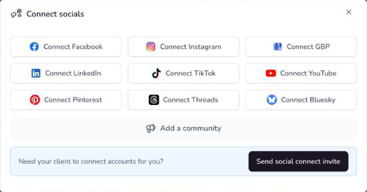

The Social Planner lets you schedule one piece of content to all of your connected channels. Setup takes some work up front, but once it's done a single video can go out to six or seven channels.

## Connect your accounts

1. In PracticeOS, go to **Marketing → Social Planner**.
2. Click **Socials** in the top right to open **Connect socials**.
3. Click the button for each business profile you have: Facebook, Instagram, LinkedIn, YouTube, TikTok, and Google Business Profile (shown as GBP).
4. Sign in with each provider when prompted and approve the requested permissions.

<Frame caption="The Connect socials dialog in Social Planner">
  
</Frame>

<Warning>
  Never send us your passwords. You authorize each account yourself through the provider's own sign-in.
</Warning>

Connecting your accounts also lets comments on your posts appear in the contact's conversation view.

## If you don't have Meta business accounts yet

Facebook and Instagram are managed together through **Meta Business Suite**. It holds your business portfolio, your Facebook page, your Instagram account, and your ad account in one place.

- You need a Facebook account, or another authorized Meta account, to manage it.
- If you don't want to tie it to your personal Facebook, you can create a Meta business account with your work email.
- Once you have a Facebook page and an Instagram business profile under the same business, they link well together.

Meta's setup can be cumbersome. If you get stuck, bring it to a weekly growth call or [ask for help](/support).

## Secure your handles

Even if you're not ready to post on every platform, we recommend claiming your business pages and handles on Facebook, Instagram, LinkedIn, YouTube, and TikTok now so they're yours when you need them.
