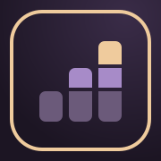
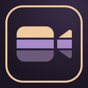

PracticeOS has two memberships. Start with the one you joined.

<Columns cols={2}>
  <Card href="/growth-system/quickstart">
    

      
      Growth System
    

    The PracticeOS platform, your 1:1 onboarding, and weekly group growth calls.
  </Card>
  <Card href="/content-engine/quickstart">
    

      
      Content Engine
    

    You record with us. We edit, caption, schedule, and distribute your content.
  </Card>
</Columns>

## Book a call

<Columns cols={2}>
  <Card href="https://links.privatepracticeos.app/widget/booking/hGtTMjeeu2mF9Bz54xqu">
    

      
      Onboarding call
    

    Growth System members: your 1:1 setup session.
  </Card>
  <Card href="https://links.privatepracticeos.app/widget/booking/oy6tQhe4mBpy6NSwzOwW">
    

      
      Content session
    

    Content Engine members: your 60-minute recording with Zack Scriven.
  </Card>
  <Card href="https://links.privatepracticeos.app/widget/booking/lQt2Gsbnt47L3fcfA6ox">
    

      
      Support call
    

    Members: get help with something you're stuck on.
  </Card>
  <Card href="https://links.privatepracticeos.app/widget/booking/KNII4tAxR5YbSrHQsu8q">
    

      
      Demo call
    

    Not a member yet? See PracticeOS and ask questions.
  </Card>
</Columns>

## Onboarding form

New member? [Fill out the onboarding form](https://links.privatepracticeos.app/widget/form/LaAMeIB7Jq8Vaz9d9W37) before your first call or recording session.

## Common questions

<Columns cols={2}>
  <Card title="How do I prepare for my 1:1 onboarding?" href="/growth-system/onboarding-call" />
  <Card title="How do I prepare for my first content session?" href="/content-engine/prepare-for-your-session" />
  <Card title="How do I connect my email and calendar?" href="/growth-system/email-calendar" />
  <Card title="How do I get help?" href="/support" />
</Columns>
